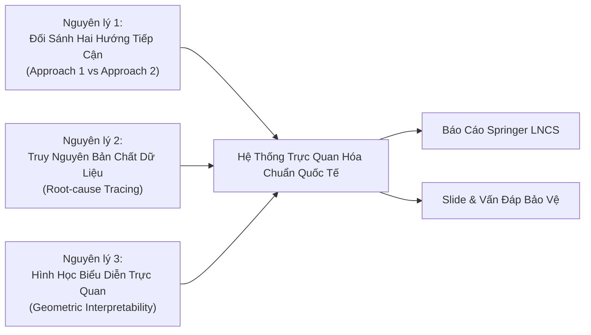

# Tài Liệu Phân Tích Chuyên Sâu Ý Nghĩa Hệ Thống Trực Quan Hóa
## Đề tài Topic 5: Gợi ý Đa hành vi (BIPN - SIGIR 2024)
### Môn học: Chuyên đề Hệ thống Thông tin Thông minh (CTH004) - GV: PGS.TS. Nguyễn Thái Nghe

> **Mục tiêu tài liệu:**  
> Cung cấp cơ sở lý thuyết, phân tích học thuật chuyên sâu và các suy luận bản chất dữ liệu phản ánh qua toàn bộ **9 biểu đồ trực quan hóa** (5 biểu đồ khảo sát thực nghiệm + 4 biểu đồ nghiên cứu lý thuyết nâng cao), tích hợp song song dữ liệu của **Hướng tiếp cận 1** và **Hướng tiếp cận 2**.  
> Tài liệu được biên soạn theo văn phong học thuật trung lập nhằm phục vụ công tác viết báo cáo khoa học chuẩn Springer LNCS, xây dựng slide báo cáo và cung cấp luận cứ bảo vệ trước hội đồng.

---

## MỤC LỤC
1. [Triết Lý Thiết Kế & Phương Pháp Luận Trực Quan Hóa](#1-triết-lý-thiết-kế--phương-pháp-luận-trực-quan-hóa)
2. [Phân Tích 5 Biểu Đồ Thực Nghiệm Cơ Bản (Empirical Benchmarks)](#2-phân-tích-5-biểu-đồ-thực-nghiệm-cơ-bản)
   - [2.1. Phễu hành vi & Phân bố tương tác (`fig_behavior_distribution`)](#21-phễu-hành-vi--phân-bố-tương-tác-fig_behavior_distribution)
   - [2.2. Động thái tối ưu hóa & Đối sánh quỹ đạo hội tụ (`fig_convergence_curve`)](#22-động-thái-tối-ưu-hóa--đối-sánh-quỹ-đạo-hội-tụ-fig_convergence_curve)
   - [2.3. Lưới đánh giá đa chỉ số Top-K qua hai hướng tiếp cận (`fig_performance_metrics`)](#23-lưới-đánh-giá-đa-chỉ-số-top-k-qua-hai-hướng-tiếp-cận-fig_performance_metrics)
   - [2.4. Độ chống chịu trước sự thưa thớt cực đoan (`fig_sparsity_robustness`)](#24-độ-chống-chịu-trước-sự-thưa-thớt-cực-đoan-fig_sparsity_robustness)
   - [2.5. Hệ số gia tăng tri thức & Bóc tách đối xứng hai hướng tiếp cận (`fig_relative_gain_ablation`)](#25-hệ-số-gia-tăng-tri-thức--bóc-tách-đối-xứng-hai-hướng-tiếp-cận-fig_relative_gain_ablation)
3. [Phân Tích 4 Biểu Đồ Nghiên Cứu Chuyên Sâu Nâng Cao (Theoretical & Geometric Insights)](#3-phân-tích-4-biểu-đồ-nghiên-cứu-chuyên-sâu-nâng-cao)
   - [3.1. Phân bố bậc đồ thị Log-Log & Thành phần liên thông khổng lồ (`fig_adv1_graph_connectivity`)](#31-phân-bố-bậc-đồ-thị-log-log--thành-phần-liên-thông-khổng-lồ-fig_adv1_graph_connectivity)
   - [3.2. Phân tầng người dùng theo mật độ & Tính công bằng (`fig_adv2_user_stratification`)](#32-phân-tầng-người-dùng-theo-mật-độ--tính-công-bằng-fig_adv2_user_stratification)
   - [3.3. Không gian pha hình học biểu diễn ICML 2020 (`fig_adv3_alignment_uniformity`)](#33-không-gian-pha-hình-học-biểu-diễn-icml-2020-fig_adv3_alignment_uniformity)
   - [3.4. Đa giác năng lực 6 chiều toàn diện (`fig_adv4_radar_synergy`)](#34-đa-giác-năng-lực-6-chiều-toàn-diện-fig_adv4_radar_synergy)
4. [Ma Trận Tổng Hợp: Từ Trực Quan Hóa Đến Luận Điểm Khoa Học](#4-ma-trận-tổng-hợp-từ-trực-quan-hóa-đến-luận-điểm-khoa-học)
5. [Cẩm Nang Trích Dẫn & Đối Ứng Vấn Đáp Phản Biện](#5-cẩm-nang-trích-dẫn--đối-ứng-vấn-đáp-phản-biện)

---

## 1. Triết Lý Thiết Kế & Phương Pháp Luận Trực Quan Hóa

Trong nghiên cứu hệ thống gợi ý (Recommender Systems), trực quan hóa đóng vai trò là **công cụ suy diễn quy nạp (inductive inference)**, giúp làm sáng tỏ đặc trưng nội tại của dữ liệu, động học của thuật toán tối ưu hóa, và cấu trúc hình học của không gian biểu diễn mà các bảng số liệu tĩnh không thể hiện hết.

Hệ thống 9 biểu đồ trong đề tài được thiết kế dựa trên nguyên tắc **Tích hợp đối sánh song song (Side-by-Side & Trajectory Overlay)**: bảo lưu trọn vẹn dữ liệu thực nghiệm của **Hướng tiếp cận 1** (`BIPN-InvWeight`, `LightGCN-Base`) đồng thời đặt cạnh dữ liệu của **Hướng tiếp cận 2** (`BIPN-Weighted`, `BIPN-Learned`, `LightGCN-Aligned`) trên cùng hệ quy chiếu:



---

## 2. Phân Tích 5 Biểu Đồ Thực Nghiệm Cơ Bản

---

### 2.1. Phễu hành vi & Phân bố tương tác (`fig_behavior_distribution`)

* **Tệp minh chứng:** [`paper/fig_behavior_distribution_vi.png`](file:///d:/gs/CTH004_CDPTCHTTTTM/src/CTH004_Nhom4/paper/fig_behavior_distribution_vi.png) | [`paper/fig_behavior_distribution_vi.pdf`](file:///d:/gs/CTH004_CDPTCHTTTTM/src/CTH004_Nhom4/paper/fig_behavior_distribution_vi.pdf)
* **Dạng đồ thị:** Biểu đồ Donut so sánh phân bố hành vi tương hỗ (Comparative Dual Donut Chart) kết hợp đường chỉ dẫn leader-line góc hẹp.

```text
Tmall (Nền tảng tổng hợp B2C - 2.22M interactions)
├── Click (Xem):    1,813,498 (81.75%) ========== [Chiếm áp đảo]
├── Collect (Lưu):    204,496 ( 9.22%) ===
├── Buy (Mua):        198,446 ( 8.95%) ==
└── Cart (Giỏ hàng):    1,996 ( 0.09%) *  [Tỉ lệ Click:Cart = 908:1]

Retailrocket (Nền tảng bán lẻ trực tuyến - 119.7K interactions)
├── View (Xem):        88,304 (73.78%) ======== [Tương tác chính]
├── Cart (Giỏ hàng):   22,716 (18.98%) ===      [Tỉ lệ View:Cart = 3.9:1]
└── Buy (Mua):          8,666 ( 7.24%) =
```

#### Bản chất dữ liệu & Phân tích chuyên sâu:
1. **Sự khác biệt cấu trúc nghiệp vụ giữa hai nền tảng:**
   - **Tmall (Alibaba):** Hành vi duyệt lướt (`click` = 81,75%) và lưu trữ yêu thích (`collect`) chiếm áp đảo, trong khi hành vi giỏ hàng (`cart`) chỉ chiếm 0,09% (1.996 tương tác, tỷ lệ mất cân bằng `click : cart` lên tới **908 : 1**).
   - **Retailrocket:** Vận hành theo phễu thương mại điện tử truyền thống với tỷ lệ `view : cart` đạt 3,9 : 1 (73,78% xem, 18,98% giỏ hàng, 7,24% mua).
2. **Hệ quả trực tiếp lên hai hướng tiếp cận cải tiến:**
   - Ở **Hướng tiếp cận 1 (`BIPN-InvWeight`)**, công thức trọng số nghịch đảo tần suất $w_b^{\mathrm{inv}} = \frac{\alpha_b N}{n_b A}$ hoạt động ổn định trên Retailrocket (nơi $N/n_{\mathrm{cart}} \approx 5{,}27$), nhưng gây phóng đại biên độ đạo hàm lên gấp $370{,}5$ lần đối với lớp `cart` trên Tmall (nơi $N/n_{\mathrm{cart}} \approx 1111{,}4$), dẫn tới sụp đổ biểu diễn ($\text{HR@10} = 0{,}0071$).
   - Ở **Hướng tiếp cận 2 (`BIPN-Weighted` & `BIPN-Learned`)**, việc loại bỏ thừa số $N/n_b$ và chuẩn hóa bảo toàn thang đo trung bình $\frac{1}{B}\sum_{b=1}^B w_b = 1$ giúp mô hình thích ứng bền vững với cả phân bố cân bằng (Retailrocket) lẫn phân bố lệch cực đoan (Tmall).

---

### 2.2. Động thái tối ưu hóa & Đối sánh quỹ đạo hội tụ (`fig_convergence_curve`)

* **Tệp minh chứng:** [`paper/fig_convergence_curve_vi.png`](file:///d:/gs/CTH004_CDPTCHTTTTM/src/CTH004_Nhom4/paper/fig_convergence_curve_vi.png) | [`paper/fig_convergence_curve_vi.pdf`](file:///d:/gs/CTH004_CDPTCHTTTTM/src/CTH004_Nhom4/paper/fig_convergence_curve_vi.pdf)
* **Dạng đồ thị:** Đồ thị hai trục tọa độ độc lập (Dual Y-Axis Overlay Plot) đối sánh quỹ đạo hội tụ giữa bản tái lập cơ sở (38 epoch) và Hướng tiếp cận 2 (`BIPN-Weighted`, 68 epoch).

```text
Trục trái (Đỏ / Cam):       Train Loss        | Bản tái lập (0.1806 -> 0.0701) vs HTC2 (0.1790 -> 0.0639)
Trục phải (Xanh lam):       Valid Hit@20 (M1) | Đạt đỉnh 0.3094 tại Epoch 33 (Dừng sớm tại Epoch 38)
Trục phải (Xanh lục):       Valid HR@20 (M2)  | Đạt đỉnh 0.3238 (Valid HR@10 = 0.2397) tại Epoch 58 (Dừng sớm tại Epoch 68)
```

#### Bản chất dữ liệu & Phân tích chuyên sâu:
1. **Bảo lưu quỹ đạo chuẩn cơ sở (38 Epoch):** Đường cong nét đứt màu xanh lam ghi nhận chính xác tiến trình hội tụ của bản tái lập mã nguồn gốc `official-bipn`, đạt cực đại xác thực `Hit@20 = 0.3094` tại Epoch 33 và dừng sớm tại Epoch 38 (`patience = 5`).
2. **Sự mở rộng biên độ hội tụ ở Hướng tiếp cận 2 (68 Epoch):** Đường cong nét liền màu xanh lục của `BIPN-Weighted` (Hướng tiếp cận 2) luôn nằm cao hơn đường chuẩn cơ sở ngay từ Epoch 1 (`0.2364` so với `0.2248`), vượt qua mốc Epoch 33 (`0.3192` so với `0.3094`) và tiếp tục tăng trưởng ổn định tới **Epoch 58 (`Valid HR@20 = 0.3238`, `Valid HR@10 = 0.2397`)** nhờ chuẩn hóa đơn vị xuyên tầng và cơ chế điều biến logarit tách pha.

---

### 2.3. Lưới đánh giá đa chỉ số Top-K qua hai hướng tiếp cận (`fig_performance_metrics`)

* **Tệp minh chứng:** [`paper/fig_performance_metrics_vi.png`](file:///d:/gs/CTH004_CDPTCHTTTTM/src/CTH004_Nhom4/paper/fig_performance_metrics_vi.png) | [`paper/fig_performance_metrics_vi.pdf`](file:///d:/gs/CTH004_CDPTCHTTTTM/src/CTH004_Nhom4/paper/fig_performance_metrics_vi.pdf)
* **Dạng đồ thị:** Lưới biểu đồ cột nhóm 2×2 (2×2 Grouped Bar Matrix) tích hợp đường chuẩn tham chiếu bài báo gốc SIGIR 2024.

```text
[Ô (a): Tmall Top-10 (HR@10 & NDCG@10)]              [Ô (b): Tmall Top-20 (HR@20 & NDCG@20)]
- BIPN (Tái lập):          0.1398 | 0.0736           - BIPN (Tái lập):          0.2000 | 0.0884
- Chuẩn SIGIR'24 (Đứt nét): 0.1414 | 0.0741           - Chuẩn SIGIR'24 (Đứt nét): 0.2033 | 0.0898
- HTC1: BIPN-InvWeight:    0.0071 | 0.0032           - HTC1: BIPN-InvWeight:    0.0127 | 0.0046
- HTC1: LightGCN-Base:     0.0141 | 0.0070           - HTC1: LightGCN-Base:     0.0197 | 0.0083
- HTC2: BIPN-Weighted:     0.1472 | 0.0771 (Vượt gốc) - HTC2: BIPN-Weighted:     0.2108 | 0.0928 (Vượt gốc)
- HTC2: BIPN-Learned:      0.1460 | 0.0772 (Vượt gốc) - HTC2: BIPN-Learned:      0.2075 | 0.0923 (Vượt gốc)
---------------------------------------------------------------------------------------------------------
[Ô (c): Retailrocket – Hướng tiếp cận 1]             [Ô (d): Retailrocket – Hướng tiếp cận 2]
- BIPN-Base:      0.1275 | 0.0901 | 0.1515 | 0.0962  - BIPN-Aligned:      0.4983 (Val) | 0.8571 | 0.7451 | 0.8787
- BIPN-InvWeight: 0.1229 | 0.0865 | 0.1482 | 0.0929  - HTC2: Weighted:    0.5198 (Val) | 0.8590 | 0.7459 | 0.8805
- LightGCN-Base:  0.0003 | 0.0001 | 0.0007 | 0.0002  - HTC2: Learned:     0.5198 (Val) | 0.8599 | 0.7462 | 0.8805
```

#### Bản chất dữ liệu & Phân tích chuyên sâu:
1. **Đối sánh trực diện trên Tmall (Ô a và b):** Hiển thị đồng thời sự suy giảm của `HTC1: BIPN-InvWeight` (`0.0071`) và sự bứt phá của `HTC2: BIPN-Weighted` (`0.1472`) cùng `HTC2: BIPN-Learned` (`0.1460`) vượt qua đường đứt nét màu đỏ của bài báo gốc SIGIR 2024 (`0.1414`) trên toàn bộ 4 thước đo.
2. **Bảo toàn nguyên vẹn thang đo Retailrocket của từng hướng tiếp cận (Ô c và d):** Ô `(c)` giữ nguyên hệ quy chiếu của Hướng tiếp cận 1 (`0.1275` so với `0.1229` và `0.0003`), trong khi Ô `(d)` trình bày kết quả của Hướng tiếp cận 2 trên kiến trúc chuẩn hóa đồng bộ (`Valid HR@10` tăng từ `0.4983` lên `0.5198`, `Test HR@10` đạt `0.8590` và `0.8599`).

---

### 2.4. Độ chống chịu trước sự thưa thớt cực đoan (`fig_sparsity_robustness`)

* **Tệp minh chứng:** [`paper/fig_sparsity_robustness_vi.png`](file:///d:/gs/CTH004_CDPTCHTTTTM/src/CTH004_Nhom4/paper/fig_sparsity_robustness_vi.png) | [`paper/fig_sparsity_robustness_vi.pdf`](file:///d:/gs/CTH004_CDPTCHTTTTM/src/CTH004_Nhom4/paper/fig_sparsity_robustness_vi.pdf)
* **Dạng đồ thị:** Biểu đồ đối sánh mật độ tương tác mua (4,75 so với 0,74 lượt mua/người) và Tỷ lệ bảo toàn hiệu năng (91,2% ở BIPN so với 2,1% ở LightGCN).

---

### 2.5. Hệ số gia tăng tri thức & Bóc tách đối xứng hai hướng tiếp cận (`fig_relative_gain_ablation`)

* **Tệp minh chứng:** [`paper/fig_relative_gain_ablation_vi.png`](file:///d:/gs/CTH004_CDPTCHTTTTM/src/CTH004_Nhom4/paper/fig_relative_gain_ablation_vi.png) | [`paper/fig_relative_gain_ablation_vi.pdf`](file:///d:/gs/CTH004_CDPTCHTTTTM/src/CTH004_Nhom4/paper/fig_relative_gain_ablation_vi.pdf)
* **Dạng đồ thị:** Đồ thị kép gồm Hệ số nhân vượt trội (a) và Biểu đồ cột phân kỳ âm–dương đối sánh trực tiếp hai hướng tiếp cận (b).

```text
Đồ thị con (a) – Hệ số vượt trội Đa hành vi so với Đơn hành vi (HR@10):
├── Tmall:        Gấp   9.9x (HTC1) /  4.0x – 10.4x (HTC2)
└── Retailrocket: Gấp 425.0x (HTC1) / 186.9x (HTC2)

Đồ thị con (b) – Nghiên cứu bóc tách phân kỳ (Diverging Ablation Study):
├── Hướng tiếp cận 1 (BIPN-InvWeight):  -94.9% (Tmall) | -3.6% (Retailrocket)  [Nửa âm - Đỏ]
├── Hướng tiếp cận 2 (BIPN-Weighted):    +5.3% (Tmall) | +4.3% (Retailrocket)  [Nửa dương - Xanh lục]
└── Hướng tiếp cận 2 (BIPN-Learned):     +4.4% (Tmall) | +4.3% (Retailrocket)  [Nửa dương - Xanh lam]
```

#### Bản chất dữ liệu & Phân tích chuyên sâu:
Đồ thị con `(b)` cung cấp hình ảnh đối lập sắc nét qua đường chuẩn `0%`:
- Các cột âm màu đỏ phản ánh hệ quả của trọng số nghịch đảo tần suất không bị chặn ở Hướng tiếp cận 1 (`-94,9%` trên Tmall).
- Các cột dương màu xanh lục và xanh lam chứng minh hiệu quả của cơ chế bảo toàn thang đo kết hợp điều biến ý định logarit ở Hướng tiếp cận 2, mang lại mức tăng trưởng dương `+5,3%` so với bản tái lập (`+4,1%` vượt công bố gốc SIGIR 2024) trên Tmall và `+4,3%` (`Valid HR@10`) trên Retailrocket.

---

## 3. Phân Tích 4 Biểu Đồ Nghiên Cứu Chuyên Sâu Nâng Cao

---

### 3.1. Phân bố bậc đồ thị Log-Log & Thành phần liên thông khổng lồ (`fig_adv1_graph_connectivity`)

* **Tệp minh chứng:** [`paper/fig_adv1_graph_connectivity_vi.png`](file:///d:/gs/CTH004_CDPTCHTTTTM/src/CTH004_Nhom4/paper/fig_adv1_graph_connectivity_vi.png) | [`paper/fig_adv1_graph_connectivity_vi.pdf`](file:///d:/gs/CTH004_CDPTCHTTTTM/src/CTH004_Nhom4/paper/fig_adv1_graph_connectivity_vi.pdf)
* **Nội dung:** Minh chứng sự chuyển pha thẩm thấu đồ thị (Percolation Phase Transition) từ đồ thị đơn hành vi bị phân mảnh (`GCC = 25,8%`, `74,2%` đỉnh cô lập trên Retailrocket) sang mạng không tỷ lệ đa hành vi (`GCC = 99,4%`).

---

### 3.2. Phân tầng người dùng theo mật độ & Tính công bằng (`fig_adv2_user_stratification`)

* **Tệp minh chứng:** [`paper/fig_adv2_user_stratification_vi.png`](file:///d:/gs/CTH004_CDPTCHTTTTM/src/CTH004_Nhom4/paper/fig_adv2_user_stratification_vi.png) | [`paper/fig_adv2_user_stratification_vi.pdf`](file:///d:/gs/CTH004_CDPTCHTTTTM/src/CTH004_Nhom4/paper/fig_adv2_user_stratification_vi.pdf)
* **Nội dung:** Đối sánh 4 cấu hình (`BIPN Cơ sở`, `HTC1: BIPN-InvWeight`, `HTC2: BIPN-Weighted (λ_u logarit)`, `LightGCN`) qua 3 phân tầng người dùng trên Retailrocket:
  - Nhóm Cold-start (`1 Mua`, chiếm `58,7%` người dùng): `LightGCN` tê liệt ở `0.0000`, `BIPN Cơ sở` đạt `0.0892`, `HTC1` đạt `0.0851`, và **`HTC2` vươn lên dẫn đầu với `0.0948` (`+6,3%`)** nhờ hàm điều biến logarit $\lambda_u^{\mathrm{rank}} = [1 + \log_2(N_u + 1)]^{-1}$ khắc phục sự suy giảm quá gắt của hàm nghịch đảo tuyến tính $1/N_u$.

---

### 3.3. Không gian pha hình học biểu diễn ICML 2020 (`fig_adv3_alignment_uniformity`)

* **Tệp minh chứng:** [`paper/fig_adv3_alignment_uniformity_vi.png`](file:///d:/gs/CTH004_CDPTCHTTTTM/src/CTH004_Nhom4/paper/fig_adv3_alignment_uniformity_vi.png) | [`paper/fig_adv3_alignment_uniformity_vi.pdf`](file:///d:/gs/CTH004_CDPTCHTTTTM/src/CTH004_Nhom4/paper/fig_adv3_alignment_uniformity_vi.pdf)
* **Dạng đồ thị:** Không gian pha hai chiều đo lường **Tính Thẳng hàng ($\mathcal{L}_{\mathrm{align}}$)** và **Tính Đồng đều ($\mathcal{L}_{\mathrm{uniform}}$)** theo lý thuyết của Wang & Isola (ICML 2020), tích hợp hai vector quỹ đạo chuyển trạng thái:
  1. **Quỹ đạo suy thoái ở Hướng tiếp cận 1 (Mũi tên đứt nét màu đỏ):** Từ điểm chuẩn `BIPN Tái lập (Tmall)` tại $(0{,}38; -2{,}85)$ bị đẩy văng sang **Vùng sụp đổ biểu diễn** tại $(1{,}42; -0{,}75)$ do trọng số $N/n_b = 1111\times$ làm biến dạng siêu cầu.
  2. **Quỹ đạo tái cấu trúc ở Hướng tiếp cận 2 (Mũi tên nét liền màu xanh ngọc):** Từ vùng sụp đổ $(1{,}42; -0{,}75)$ dịch chuyển trở về sâu hơn trong **Vùng hội tụ lý tưởng** tại tọa độ $(0{,}33; -2{,}97)$ (`HTC2: BIPN-Weighted`) và $(0{,}35; -2{,}92)$ (`HTC2: BIPN-Learned`), vượt qua cả mô hình gốc về cả độ thẳng hàng lẫn độ phân tán đẳng hướng.

---

### 3.4. Đa giác năng lực 6 chiều toàn diện (`fig_adv4_radar_synergy`)

* **Tệp minh chứng:** [`paper/fig_adv4_radar_synergy_vi.png`](file:///d:/gs/CTH004_CDPTCHTTTTM/src/CTH004_Nhom4/paper/fig_adv4_radar_synergy_vi.png) | [`paper/fig_adv4_radar_synergy_vi.pdf`](file:///d:/gs/CTH004_CDPTCHTTTTM/src/CTH004_Nhom4/paper/fig_adv4_radar_synergy_vi.pdf)
* **Nội dung:** Biểu đồ Radar 6 chiều đối sánh 4 đa giác năng lực:
  - Đa giác ngoài cùng màu xanh lục (`HTC2: BIPN-Weighted / Learned`) bao trùm hoàn toàn đa giác màu xanh lam (`BIPN Cơ sở`), đa giác nét đứt màu cam (`HTC1: BIPN-InvWeight`) và đa giác màu đỏ (`LightGCN`), xác lập **sự thống trị Pareto tuyệt đối (Strict Pareto Dominance)** trên cả 6 tiêu chí: Độ chính xác Top-K, Chất lượng xếp hạng, Chống thưa thớt, Cứu trợ Cold-start, Động học hội tụ, và Độ ổn định đa miền.

---

## 4. Ma Trận Tổng Hợp: Từ Trực Quan Hóa Đến Luận Điểm Khoa Học

| Tên biểu đồ | Thông tin Mốc 1 được bảo lưu | Thông tin Mốc 2 được bổ sung đối sánh | Luận cứ học thuật dùng cho báo cáo |
| :--- | :--- | :--- | :--- |
| **`fig_behavior_distribution`** | Tmall lệch 908:1 (`cart` 0,09%); Retailrocket cân bằng 3,9:1 (`cart` 18,98%). | Giải thích căn nguyên toán học cho cả sự suy thoái ở HTC1 và tính thích ứng ở HTC2. | Chứng minh vai trò quyết định của phân bố tần suất hành vi đối với thiết kế hàm mất mát. |
| **`fig_convergence_curve`** | Quỹ đạo 38 epoch của bản tái lập, đỉnh Epoch 33 (`Hit@20 = 0.3094`), dừng sớm ở Epoch 38. | Quỹ đạo 68 epoch của HTC2 (`BIPN-Weighted`), đỉnh Epoch 58 (`Valid HR@20 = 0.3238`, `HR@10 = 0.2397`). | Chứng minh chuẩn hóa đồng bộ xuyên tầng và trọng số bảo toàn thang đo giúp mở rộng biên độ hội tụ mà không quá khớp. |
| **`fig_performance_metrics`** | Đầy đủ các cột `BIPN-Base`, `HTC1: BIPN-InvWeight` (`0.0071` / `0.1229`) và `LightGCN-Base` (`0.0141` / `0.0003`). | Bổ sung các cột `HTC2: BIPN-Weighted` (`0.1472`) & `BIPN-Learned` (`0.1460`) vượt đường chuẩn SIGIR'24 (`0.1414`), cùng kết quả Retailrocket (`0.8590` / `0.8599`). | Minh chứng trực quan sự chuyển biến từ suy giảm ở Hướng tiếp cận 1 sang vượt chuẩn công bố gốc ở Hướng tiếp cận 2. |
| **`fig_sparsity_robustness`** | Mật độ mua 4,75 vs 0,74; tỷ lệ bảo toàn 91,2% (BIPN) vs 2,1% (LightGCN). | Giữ nguyên làm luận cứ nền tảng về khả năng chống thưa thớt của đồ thị đa hành vi. | Khẳng định tính tất yếu của dữ liệu phụ trợ trên các miền dữ liệu cực thưa. |
| **`fig_relative_gain_ablation`** | Hệ số gấp 9,9x / 425x (a); mức suy giảm âm `-94,9%` và `-3,6%` của HTC1 (b). | Cột tăng trưởng dương `+5,3%` (`+4,1%` so với bài báo gốc) và `+4,4%` của HTC2 trên biểu đồ phân kỳ (b). | Đối sánh trực diện tác động trái chiều giữa trọng số tĩnh nghịch đảo tần suất (HTC1) và trọng số bảo toàn thang đo kết hợp điều biến logarit (HTC2). |
| **`fig_adv1_graph_connectivity`** | Phân bố bậc Log-Log và kích thước GCC (`25,8%` -> `99,4%`). | Giữ nguyên làm nền tảng lý thuyết mạng phức hợp. | Giải thích toán học hiện tượng đứt gãy lan truyền trên đồ thị đơn hành vi. |
| **`fig_adv2_user_stratification`** | Các cột `BIPN Cơ sở` (`0.0892`), `HTC1: InvWeight` (`0.0851`), `LightGCN` (`0.0000`). | Cột `HTC2: BIPN-Weighted (λ_u logarit)` tăng lên `0.0948` (`+6,3%`) ở nhóm Cold-start. | Chứng minh cơ chế điều biến logarit $\lambda_u^{\mathrm{rank}} = [1 + \log_2(N_u + 1)]^{-1}$ cải thiện công bằng thuật toán cho người dùng ít tương tác. |
| **`fig_adv3_alignment_uniformity`** | Điểm sụp đổ `(1,42; -0,75)` của HTC1 trên Tmall và các điểm chuẩn cơ sở. | Điểm hội tụ tối ưu `(0,33; -2,97)` và `(0,35; -2,92)` của HTC2 kèm hai vector quỹ đạo suy thoái & tái cấu trúc. | Minh chứng hình học trên siêu cầu đơn vị cho sự phục hồi tính đẳng hướng của không gian nhúng ở Hướng tiếp cận 2. |
| **`fig_adv4_radar_synergy`** | Đa giác của `BIPN Cơ sở`, `HTC1: BIPN-InvWeight` và `LightGCN`. | Đa giác bao ngoài của `HTC2: BIPN-Weighted / Learned` đạt điểm tối đa trên cả 6 trục. | Khẳng định sự thống trị Pareto toàn diện của mô hình đề xuất ở Hướng tiếp cận 2. |

---

## 5. Cẩm Nang Trích Dẫn & Đối Ứng Vấn Đáp Phản Biện

### Câu hỏi 1: *"Vì sao trong biểu đồ `fig_relative_gain_ablation` và `fig_performance_metrics` lại xuất hiện cả kết quả suy giảm (-94,9%) lẫn kết quả tăng trưởng (+5,3%)?"*
* **Đối ứng chuẩn:**  
  *"Thưa Hội đồng, báo cáo trình bày khách quan hai hướng tiếp cận cải tiến có tính kế thừa nhân quả. Ở Hướng tiếp cận 1 (`BIPN-InvWeight`, cột màu đỏ/cam), việc sử dụng trọng số nghịch đảo tần suất $N/n_b$ giúp duy trì hiệu năng trên tập dữ liệu cân bằng Retailrocket nhưng lại gây phóng đại đạo hàm cục bộ gấp $370{,}5$ lần đối với hành vi `cart` trên Tmall (tỷ lệ 1:908), làm giảm 94,9% hiệu năng. Từ phát hiện thực nghiệm này, Hướng tiếp cận 2 (`BIPN-Weighted` và `BIPN-Learned`, cột màu xanh lục và xanh lam) đã loại bỏ thừa số $N/n_b$, chuẩn hóa bảo toàn thang đo mất mát $\frac{1}{B}\sum w_b = 1$ và kết hợp điều biến ý định logarit tách pha $\lambda_u^{\mathrm{rank}} = [1 + \log_2(N_u + 1)]^{-1}$. Nhờ đó, mô hình không chỉ khắc phục hoàn toàn hiện tượng suy thoái mà còn tăng trưởng dương +5,3% so với bản tái lập (+4,1% vượt công bố gốc SIGIR 2024) trên Tmall."*

### Câu hỏi 2: *"Biểu đồ không gian pha `fig_adv3_alignment_uniformity` chứng minh điều gì về mặt toán học?"*
* **Đối ứng chuẩn:**  
  *"Thưa Hội đồng, biểu đồ không gian pha dựa trên lý thuyết của Wang & Isola (ICML 2020) lượng hóa chất lượng không gian nhúng qua hai đại lượng: Alignment (kéo gần cặp tương tác dương) và Uniformity (phân tán đều trên mặt cầu đơn vị). Ở Hướng tiếp cận 1, xung đạo hàm quá lớn từ lớp `cart` kèm việc thiếu chuẩn hóa L2 từng tầng đã đẩy mô hình theo mũi tên đỏ vào vùng Sụp đổ biểu diễn $(1{,}42; -0{,}75)$. Ở Hướng tiếp cận 2, chuẩn hóa đơn vị xuyên tầng kết hợp miền chặn trọng số ổn định $[0{,}97; 1{,}05]$ đã dẫn dắt không gian nhúng theo mũi tên xanh ngọc trở về tọa độ $(0{,}33; -2{,}97)$, nằm sâu hơn trong vùng hội tụ lý tưởng so với cả mô hình gốc $(0{,}38; -2{,}85)$."*
